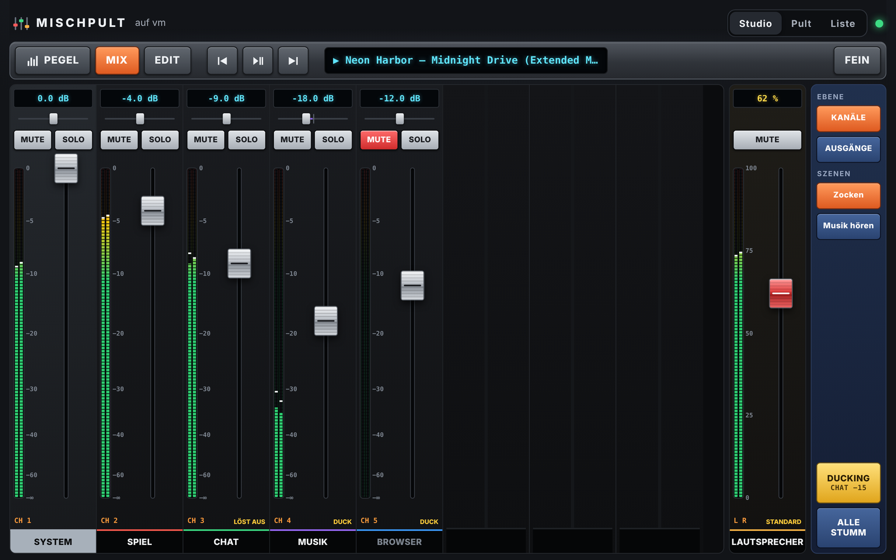
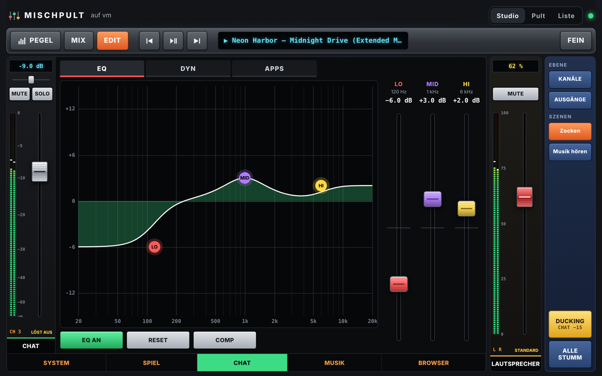

**Mischpult 4.6** – App-Audio-Mixer für Windows, made by D3r_Jan

**Herunterladen:** unten bei „Assets“ auf `Mischpult.exe` klicken, dann starten – das Ein-Klick-Fenster fragt: installieren oder nur ausprobieren. Ein Update geht genauso: neue EXE starten → „Aktualisieren“, deine Einstellungen bleiben.

### Neu in 4.6 – das Tablet als Studio-Pult
Die Fernbedienung hat eine neue Ansicht **„Studio“** im Stil großer Digitalpulte – auf dem Tablet ist sie der Start (oben „Studio | Pult | Liste“).
- **MIX:** alle Kanalzüge mit Wert, Balance, MUTE, SOLO, Stereo-Pegel und Fader, rechts der Ausgang.
- **Seitenleiste:** Ebenen (Kanäle, Gruppen, Ausgänge), Szenen, DUCKING mit „wer löst aus“, ALLE STUMM.
- **EDIT** (Kanalnamen zweimal antippen): **EQ-Kurve zum Ziehen** mit LO, MID und HI, dazu EQ AN, RESET, COMP. **DYN** (Kompressor, Lautstärke-Ausgleich), **APPS** (jede App mit eigenem Fader), **STREAM**-Anteil.
- **PEGEL:** alle Kanäle und Ausgänge als große Stereo-Pegel.
- **Musik-Tasten** (zurück, Play/Pause, weiter) und oben im Display, was gerade läuft.
- Abschaltbar: „Studio-Ansicht fürs Tablet“ und „Musik-Tasten am Handy“ unter der Fernbedienung.

### Zuletzt neu
- **4.5.2** – schmale Kanäle im Pult, Breite S, M, L
- **4.5.1** – alle Ausgänge, FEIN und Feineinstellung in 0,1-dB-Schritten
- **4.5** – Tablet als Mischpult: senkrechte Fader, EQ, PAN, SOLO und COMP

**Windows warnt?** Die EXE ist nicht digital signiert. Bei „Der Computer wurde durch Windows geschützt“: *Weitere Informationen → Trotzdem ausführen*. Meldet Defender einen Virus, ist das ein Fehlalarm – siehe README.

Voraussetzungen: Windows 10 (ab 2004) oder 11, .NET Framework 4.8 (schon in Windows enthalten).
