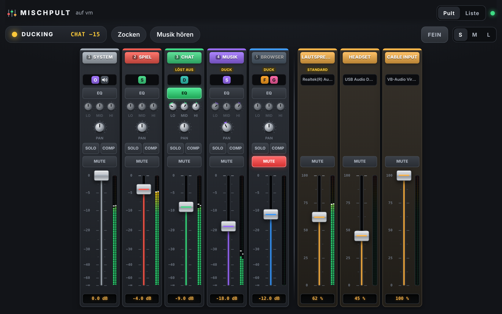

**Mischpult 4.5.2** – App-Audio-Mixer für Windows, made by D3r_Jan

**Herunterladen:** unten bei „Assets“ auf `Mischpult.exe` klicken, dann starten – das Ein-Klick-Fenster fragt: installieren oder nur ausprobieren. Ein Update geht genauso: neue EXE starten → „Aktualisieren“, deine Einstellungen bleiben.

### Neu in 4.5.2 – schmale Kanäle
- Im Pult auf dem Tablet sind die Kanäle jetzt **schmal** wie an einem echten Mischpult – so passen mehr auf den Bildschirm.
- Oben rechts neben FEIN die Breite wählen: **S** (schmal, Standard), **M** (mittel), **L** (füllt den Bildschirm). Das Tablet merkt sich die Wahl.

### Neu in 4.5.1 – alle Ausgänge und feiner einstellen
- **Alle Ausgänge** in der Fernbedienung: Lautsprecher, Kopfhörer, HDMI, virtuelle Kabel – mit Lautstärke, MUTE und Pegel. Der Standard-Ausgang trägt „STANDARD“. Im Pult rechts wie am PC. Schalter „Alle Ausgänge am Handy“.
- Taste **FEIN**: Fader und Drehregler bewegen sich 4× langsamer, EQ in **0,1-dB-Schritten**.
- **Wert antippen = fein einstellen**: Tasten für ±0,1 / ±1 dB (Ausgänge ±1 / ±5 %), EQ LO/MID/HI und PAN – Taste halten = weiterzählen. Geht auch in der Liste am Handy.
- Feiner gezeichnet: **Stereo-LED-Pegel** mit Spitzenwert, Skalenstriche an Fadern und Drehreglern, Kanalnummern.

### Zuletzt neu
- **4.5** – Tablet als Mischpult: senkrechte Fader, EQ, PAN, SOLO und COMP im Browser
- **4.4.1** – Fernbedienung zuverlässiger, Firewall-Prüfung mit „Firewall freigeben“
- **4.4** – Fernbedienung vom Handy: Kanäle, Apps, Ausgang, Szenen und DUCKING im Browser

**Windows warnt?** Die EXE ist nicht digital signiert. Bei „Der Computer wurde durch Windows geschützt“: *Weitere Informationen → Trotzdem ausführen*. Meldet Defender einen Virus, ist das ein Fehlalarm – siehe README.

Voraussetzungen: Windows 10 (ab 2004) oder 11, .NET Framework 4.8 (schon in Windows enthalten).
