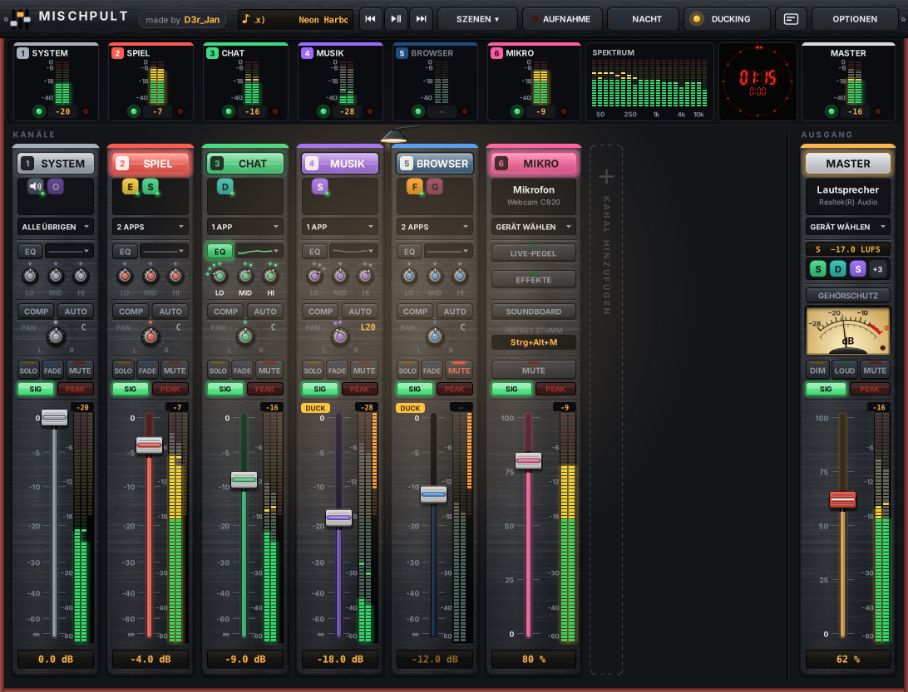
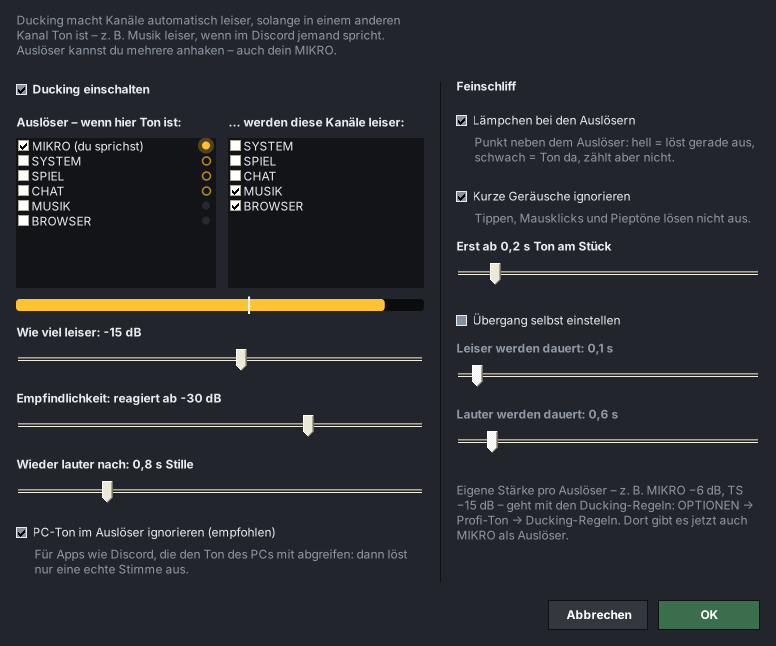
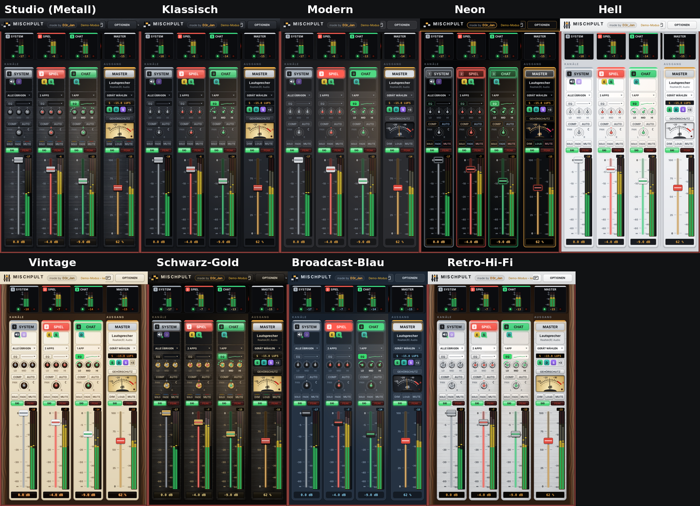
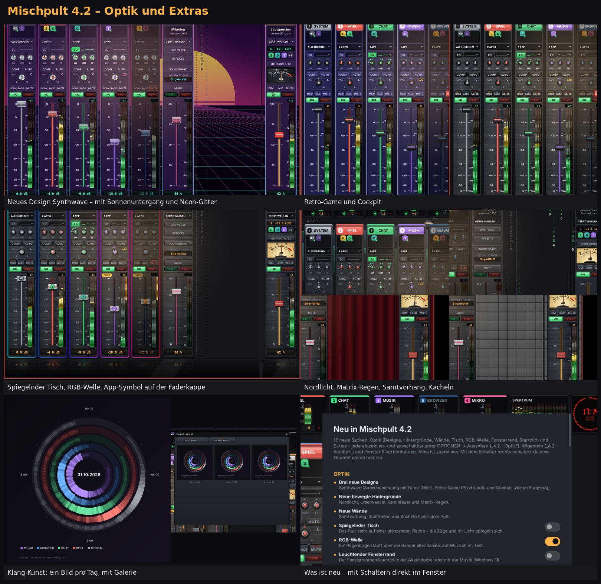
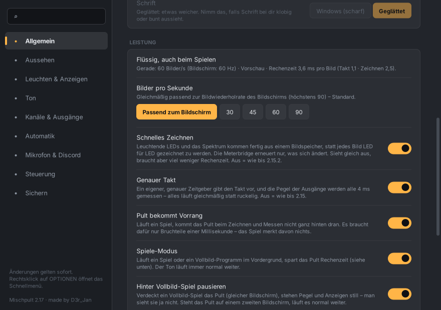

<div align="center">

# Mischpult

**Der App-Mixer für Windows – jede App auf ihrem eigenen Fader, im Look eines echten Studiopults.**

made by **D3r_Jan** · Version 4.2.5 · Windows 10 / 11 · kostenlos

### [⬇ Mischpult.exe herunterladen](../../releases/latest)



</div>

---

## Worum geht's?

Windows hat nur einen kleinen Lautstärkemixer. Das **Mischpult** macht daraus ein richtiges Pult: Du verteilst deine Apps auf Kanäle wie **SPIEL**, **CHAT**, **MUSIK** und **BROWSER** und regelst jeden Kanal mit Fader, EQ, Kompressor und Pegelanzeige – so wie an einem echten Mischpult im Studio.

- **Kein Treiber, keine Admin-Rechte.** Das Mischpult nutzt nur, was in Windows schon drin ist.
- **Eine einzige Datei.** EXE herunterladen, starten, fertig. Installieren geht mit einem Klick, ist aber kein Muss.
- **Alles ist abschaltbar.** Jede Funktion lässt sich einzeln ein- und ausschalten. Neue Funktionen sind erst einmal aus.

## Das kann es (eine Auswahl)

**Mischen**
- Apps per Klick auf Kanäle verteilen – Discord, TeamSpeak, Spotify, Browser und Co. werden automatisch sortiert, Spiele landen von selbst im Kanal SPIEL
- Pro Kanal: Fader, MUTE, SOLO, Balance, FADE-Taste, Lautstärke pro App
- Gruppen, Mute-Gruppen, Crossfader, eigenes Ausgabegerät pro Kanal
- **Szenen**: den kompletten Mix auf Knopfdruck laden – auch nach Uhrzeit oder automatisch pro Spiel
- **Stream-Mix** für OBS und **Sprach-Ausgang** für Discord (mit virtuellem Audiokabel)

**Klang**
- 3-Band-EQ pro Kanal, großer und parametrischer EQ, Kopfhörer-Profile
- Kompressor, Nachtmodus, Loudness bei leisem Hören
- **Gehörschutz** gegen plötzlich laute Knaller und eine Lautstärke-Obergrenze
- Profi-Ton: De-Esser, Wärme, Rauschsperre, Hall-Bus, Limiter für den Stream und mehr

**Ducking**
- Musik wird automatisch leiser, sobald im Discord oder TeamSpeak jemand spricht – oder wenn **du selbst** sprichst (MIKRO als Auslöser)
- Mehrere Auslöser, Lämpchen, die zeigen, wer gerade auslöst, kurze Geräusche (Tippen, Klicks) ignorieren, einstellbarer Übergang
- Eigene Regeln mit eigener Stärke pro Auslöser, z. B. MIKRO −6 dB und TS −15 dB

**Anzeigen**
- Pegel in Echtzeit mit SIG- und PEAK-Leuchten, VU-Meter mit Zeiger, Meterbridge
- Spektrum, Wasserfall, Lautheit (LUFS), Stereo-Bild, „Jetzt läuft“ mit Cover

**Optik**
- **18 Designs** – von Studio-Metall über Vintage, Neon und Holz & Messing bis Synthwave, Retro-Game und Cockpit
- Bewegte Hintergründe, Wände hinter dem Pult, Pultlampe, RGB-Welle, spiegelnder Tisch – alles einzeln abschaltbar

**Bedienung**
- Tastenkürzel, die überall funktionieren – auch im Spiel
- MIDI-Controller, Xbox-Controller, Mini-Ansicht, Overlay, Desktop-Widget
- Einstellungsfenster mit Suche (Strg+F) und Übersicht „Was ist eingeschaltet“

## Download und Installation

1. Unter **[Releases](../../releases/latest)** die neueste `Mischpult.exe` herunterladen.
2. Doppelklick auf die Datei. Es erscheint ein Fenster mit zwei Möglichkeiten:
   - **Installieren** – Startmenü, Desktop-Verknüpfung und Eintrag unter Windows → Apps, ohne Admin-Rechte.
   - **Nur ausprobieren** – startet ohne Installation.
3. Fertig.

**Aktualisieren:** Die neue `Mischpult.exe` einfach starten (oder aufs offene Pult ziehen) und **Aktualisieren** klicken. Die alte Version beendet sich von selbst, deine Einstellungen bleiben erhalten.

**Oder automatisch:** Unter OPTIONEN → Allgemein **„Online nach Updates suchen“** einschalten – dann meldet sich das Pult, sobald es hier eine neue Version gibt, und aktualisiert sich mit einem Klick. Mit **„Updates automatisch installieren“** passiert das beim Start sogar ganz von selbst. Beide Schalter sind zuerst aus.

**Deinstallieren:** Windows-Einstellungen → **Apps** → Mischpult → Deinstallieren. Auf Wunsch kommen dabei auch die Einstellungen mit weg.

### Windows warnt beim Start?

Das Mischpult ist nicht digital signiert. Deshalb kann Windows bei neuen Versionen misstrauisch sein:

- **„Der Computer wurde durch Windows geschützt“** – auf **Weitere Informationen → Trotzdem ausführen** klicken.
- **Virenwarnung von Microsoft Defender** – das ist ein Fehlalarm, wie er bei neuen, nicht signierten Programmen vorkommt. Unter **Windows-Sicherheit → Viren- & Bedrohungsschutz → Schutzverlauf** den Eintrag mit `Mischpult.exe` öffnen und **Zulassen** bzw. **Wiederherstellen** wählen. Fehlalarme lassen sich bei Microsoft melden: [microsoft.com/wdsi/filesubmission](https://www.microsoft.com/wdsi/filesubmission).

Der komplette Quellcode liegt hier im Projekt – jeder kann nachsehen, was das Mischpult macht.

## Voraussetzungen

- **Windows 10 oder 11.** EQ, Kompressor, Nachtmodus, Stream-Mix, Soundboard und Sprach-Ausgang brauchen Windows 10 Version 2004 oder neuer.
- **.NET Framework 4.8** – ist in Windows 10 (ab 1903) und Windows 11 schon enthalten.
- Optional für Stream-Mix und Sprach-Ausgang: ein virtuelles Audiokabel, z. B. [VB-Cable](https://vb-audio.com/Cable/) (kostenlos).

## Kurzanleitung

| Was | So geht's |
|---|---|
| Lautstärke | Fader ziehen oder Mausrad über dem Kanal · **Shift** beim Ziehen = fein · Doppelklick = 0 dB |
| Apps zuordnen | Klick auf das App-Feld eines Kanals, Häkchen setzen |
| Szenen | **SZENEN** oben: Mix speichern und mit einem Klick wieder laden |
| Ducking | **DUCKING** oben schaltet es an und aus, **Rechtsklick** öffnet die Einstellungen |
| Einstellungen | **OPTIONEN** oben rechts · **Strg+F** sucht in allen Einstellungen |
| Vorschau ohne Ton | `Mischpult.exe --demo` |



## Gut zu wissen

- Das Mischpult regelt die **Windows-Lautstärke der Apps** – dieselbe wie im Windows-Lautstärkemixer. Beim Beenden bleiben die normalen Werte erhalten.
- **EQ und Kompressor:** Windows hat keinen EQ pro App. Ist er an, nimmt das Mischpult den Ton der App direkt ab (Windows-Funktion „Prozess-Loopback“), bearbeitet ihn und gibt ihn wieder aus. Diese Kanäle haben dadurch etwa 30–50 ms Verzögerung.
- Apps im **Exklusivmodus** (ASIO / WASAPI exklusiv) lassen sich von Windows aus nicht regeln.
- **Einstellungen** liegen unter `Dokumente\Mischpult`. Unter OPTIONEN → Sichern lassen sie sich exportieren oder als **Umzugs-Paket** auf einen neuen PC mitnehmen.
- **Datenschutz:** Das Mischpult schickt nichts ins Internet. Ausnahmen gibt es nur, wenn du sie selbst einschaltest: „Online nach Updates suchen“ (fragt bei GitHub nach einer neuen Version), OBS (auf deinem PC) und WLED (in deinem Heimnetz).

## Bilder

**18 Designs** – umschaltbar unter OPTIONEN → Aussehen → Design



**Optik und Extras aus Version 4.2**



**Einstellungen mit Suche**



## Selbst bauen

**Windows:** [.NET SDK](https://dotnet.microsoft.com/download) (8 oder neuer) installieren, dann im Projektordner:

```
dotnet build -c Release
```

Die EXE liegt danach unter `bin\Release\net48\Mischpult.exe`. Alternativ das Projekt in Visual Studio 2022 öffnen.

**Linux (Cross-Build):** `mono-complete` und das .NET SDK installieren, dann:

```
dotnet build -c Release -p:FrameworkPathOverride=/usr/lib/mono/4.8-api
```

### Aufbau

| Ordner | Inhalt |
|---|---|
| `src/Native` | Anbindung an Windows: Core Audio, WASAPI, Prozess-Loopback, MIDI, Direct2D |
| `src/Audio` | Audio-Thread, EQ- und Effekt-Mischer, Lautheit, Aufnahme, Sounds laden |
| `src/UI` | Oberfläche: Kanalzüge, Designs, Meterbridge, Einstellungsfenster, Dialoge |
| `src/Settings*.cs` | Kanäle, Szenen und Einstellungen (JSON) |
| `assets` | Programmsymbol und Manifest |

## Versionen

| Version | Neu |
|---|---|
| **4.2.5** | Updates automatisch installieren – neue Versionen kommen beim Start von selbst |
| **4.2.4** | Aufräumen nach Installieren und Deinstallieren ohne Hilfsbefehl im Hintergrund – weniger Fehlalarme beim Virenschutz |
| **4.2.3** | Ducking-Feinschliff: Lämpchen, kurze Geräusche ignorieren, Übergang einstellbar, MIKRO in den Ducking-Regeln |
| **4.2.2** | Ducking mit dem Mikrofon als Auslöser |
| **4.2.1** | Ducking mit mehreren Auslösern |
| **4.2** | Optik und Extras: Synthwave, Retro-Game, Cockpit, neue Hintergründe und Wände, RGB-Welle, Klang-Kunst |
| **4.1** | Einfach installieren und aktualisieren: Ein-Klick-Fenster, Update per Ziehen, Start-Schutz, Umzugs-Paket |
| **4.0** | Das große Update: parametrischer EQ, Kopfhörer-Profile, Overlay, Widget, OBS, WLED, Profi-Ton |

## Fehler gefunden oder eine Idee?

Einfach ein **[Issue](../../issues)** anlegen. Hilfreich sind dabei die Windows-Version und, falls vorhanden, die Datei `Dokumente\Mischpult\Protokolle\fehler.log`.

---

<div align="center">

**Mischpult** · made by **D3r_Jan**

</div>
